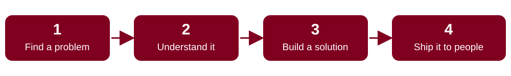

  

  
  
  
  

## 👋 Hi, I'm Mike

I'm a final-year Computer Science student at **Covenant University** and the founder of **Crymson Solutions**, a product studio that finds real problems people face every day and turns them into simple, useful software.

  

> The goal isn't to build software because we can. It's to build software because someone needs it.

**Interests:** software engineering · automation · AI · product development

---

## 🚀 What I've built

| Project | The problem | What it does | Stack |
|---|---|---|---|
| **OneEko** (Lagos State Ministry of Innovation, Science & Technology) | Residents and government have no reliable two-way channel for incidents | Incident reporting and government communication platform: agency-only posting, priority alerts, report auto-routing, emergency alerts. I led the team and pitched it to the permanent secretary and the deputy governor. | Node.js · TypeScript · PostgreSQL · React · Vite |
| **JOBALAT** ([repo](https://github.com/Michael-Olaoluwa/job-alert)) | Job hunters miss postings scattered across many boards | Telegram bot that scans job boards and sends rewritten, plain-English postings to your DMs. **50+ users, 500+ jobs delivered.** Paid tiers via Paystack. Now being rebuilt as 2.0. | React · TypeScript · Supabase · Groq · Paystack |
| **Huntzz** ([repo](https://github.com/Michael-Olaoluwa/Huntzz)) | University Telegram groups are so noisy that important messages get missed | Telegram bot that DMs you only the messages matching your keywords, from the groups you subscribe to | Node.js · grammY · Supabase |
| **EazeShare** | Moving files between devices is slower than it should be | Peer-to-peer file and text sharing straight between devices, no server storage, no accounts | React · WebRTC · Supabase |
| **StudentPadi** *(in progress)* | Students juggle tasks, deadlines and reminders across too many places | AI-assisted task manager for Nigerian university students | Supabase · AI task detection |

---

## 🛠️ What I can do

  
  
  
  
  
  
  
  
  
  
  
  
  
  
  

- **Full-stack products:** I take an idea from problem to deployed, paying product.
- **Backend and automation:** scrapers, scheduled jobs, queues, webhooks, payments, Telegram bots.
- **AI features:** LLM-powered rewriting and detection inside real products.
- **Leadership:** I led the OneEko team across frontend, backend, data and UI/UX, and pitched to senior government officials.
- **Product thinking:** I start from the user's problem, then pick the technology.

---

## 📈 Experience highlights

- **Founder & CEO, Crymson Solutions** (Sep 2026 to present): product studio building StudentPadi, JOBALAT and more.
- **Lead Software Engineer (Intern), Lagos State Ministry of Innovation, Science & Technology** (Mar 2026 to present): led the OneEko team.
- **Web Developer, Hebron Bites** (Jan 2024 to Nov 2025).
- **Website Content Manager, Covenant University** (Mar 2023 to Aug 2025).
- **Student Ambassador, Cowrywise** (Dec 2025 to present).

---

## 🐍 Contribution activity

  <picture>
    <source media="(prefers-color-scheme: dark)" srcset="https://raw.githubusercontent.com/Michael-Olaoluwa/Michael-Olaoluwa/output/github-snake-dark.svg"/>
    
  </picture>

---

## 🤝 Let's connect

I'm open to software engineering opportunities and to collaborating on products that solve real problems.

**LinkedIn:** [linkedin.com/in/michael-olaoluwa](https://linkedin.com/in/michael-olaoluwa)
